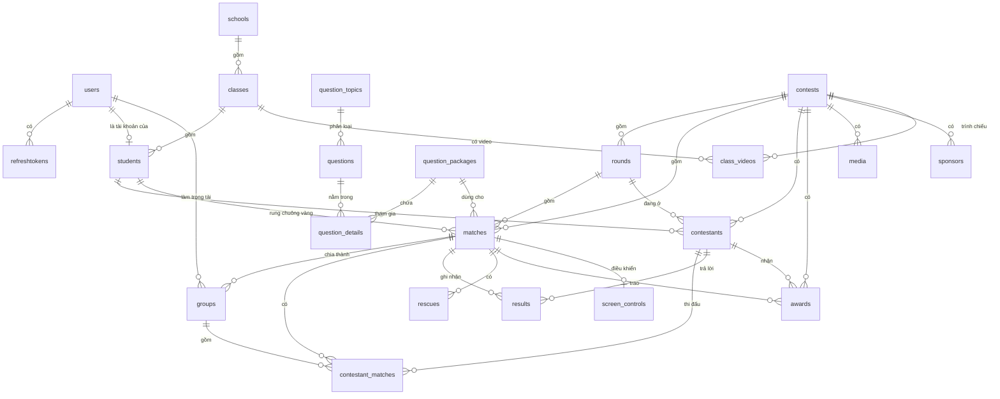

# ĐẶC TẢ THIẾT KẾ CƠ SỞ DỮ LIỆU – HỆ THỐNG "RUNG CHUÔNG VÀNG" (Contests-BE)

| Mục | Nội dung |
|---|---|
| Hệ quản trị CSDL | MySQL / MariaDB 10.4 (chạy qua XAMPP) |
| Tên CSDL | `contest_db` |
| Công cụ ánh xạ (ORM) | Prisma 6.10 |
| Nguồn định nghĩa | `src/prisma/schema.prisma` (bản thiết kế dạng DBML: `src/prisma/dbml/schema.dbml`) |
| Lịch sử thay đổi cấu trúc | `src/prisma/migrations/` (7 migration, từ 07/2025) |
| Quy mô | 23 bảng, 205 cột, 31 khoá ngoại, 11 kiểu liệt kê (enum) |

> Mọi kiểu dữ liệu, ràng buộc và quy tắc xoá trong tài liệu được đối chiếu với CSDL thực tế (`information_schema`) chứ không chỉ lấy từ file schema.

---

## 1. Mục đích và phạm vi

CSDL lưu toàn bộ dữ liệu của hệ thống tổ chức cuộc thi trắc nghiệm theo thể thức "Rung chuông vàng":

- **Người dùng và phân quyền:** tài khoản Quản trị viên (Admin), Trọng tài (Judge), Thí sinh (Student); phiên đăng nhập; mã OTP khôi phục mật khẩu.
- **Danh mục:** trường, lớp, học sinh.
- **Ngân hàng câu hỏi:** chủ đề, câu hỏi, gói câu hỏi và thứ tự câu trong gói.
- **Tổ chức cuộc thi:** cuộc thi, vòng thi, trận đấu, thí sinh, nhóm thi do trọng tài phụ trách, số báo danh trong trận.
- **Diễn biến trận đấu:** kết quả từng câu, cứu trợ / phao trợ giúp, trạng thái màn hình trình chiếu, giải thưởng.
- **Nội dung trình chiếu:** media cuộc thi, video giới thiệu lớp, nhà tài trợ, thông tin đơn vị tổ chức.

---

## 2. Quy ước thiết kế chung

### 2.1. Quy ước đặt tên
- Tên bảng ở dạng số nhiều, chữ thường (`users`, `matches`…). Trong `schema.prisma` một số bảng viết hoa giữa tên (`question_Topics`, `contestant_Matches`…); MySQL trên Windows lưu toàn bộ bằng chữ thường.
- Tên cột dạng camelCase. Một số cột được ánh xạ sang snake_case: `students.full_name`, `students.student_code`, `results.contestant_id`, `results.match_id`, `rescues.match_id`, `awards.contest_id`, `awards.contestant_id`, `awards.match_id`.

### 2.2. Cột chung
| Cột | Kiểu | Ý nghĩa |
|---|---|---|
| `id` | `INT AUTO_INCREMENT` | Khoá chính tự tăng (trừ 2 bảng trung gian dùng khoá chính kép) |
| `createdAt` | `DATETIME(3)`, mặc định `CURRENT_TIMESTAMP(3)` | Thời điểm tạo |
| `updatedAt` | `DATETIME(3)` | Thời điểm cập nhật gần nhất, do Prisma tự gán mỗi lần ghi |
| `isActive` | `TINYINT(1)`, mặc định `1` | Bật/tắt (khoá) bản ghi; nhiều chức năng "xoá" chỉ đặt cờ này về `0` (xoá mềm) |

Thời gian được lưu theo giờ UTC (giờ Việt Nam = UTC + 7).

### 2.3. Ánh xạ kiểu dữ liệu Prisma → MySQL
| Prisma | MySQL thực tế | Ghi chú |
|---|---|---|
| `Int` | `INT(11)` | |
| `String` (không chỉ định) | `VARCHAR(191)` | |
| `String @db.VarChar(n)` / `@db.Char(n)` / `@db.Text` | `VARCHAR(n)` / `CHAR(n)` / `TEXT` | |
| `Boolean` | `TINYINT(1)` | 0 = false, 1 = true |
| `DateTime` | `DATETIME(3)` | Chính xác tới mili giây |
| `Json` | `LONGTEXT` | MariaDB lưu JSON dưới dạng LONGTEXT |
| `enum` | `ENUM(...)` | Xem mục 6 |

### 2.4. Chính sách xoá
Hầu hết khoá ngoại dùng `ON DELETE RESTRICT`: **không thể xoá bản ghi cha khi còn bản ghi con** (ví dụ không xoá được cuộc thi còn vòng thi). Backend kiểm tra trước và trả thông báo lỗi dễ hiểu. Ngoại lệ được liệt kê ở mục 7.

---

## 3. Sơ đồ quan hệ thực thể (ERD)

Ký hiệu: `||--o{` = một – nhiều (không bắt buộc có con); `||--o|` = một – không hoặc một.

### 3.1. Phân nhóm bảng theo phân hệ
| Phân hệ | Bảng |
|---|---|
| Tài khoản & xác thực | `users`, `refreshtokens` |
| Danh mục đơn vị | `schools`, `classes`, `students`, `about` |
| Ngân hàng câu hỏi | `question_topics`, `questions`, `question_packages`, `question_details` |
| Cuộc thi | `contests`, `rounds`, `matches`, `contestants`, `groups`, `contestant_matches` |
| Diễn biến trận đấu | `results`, `rescues`, `screen_controls`, `awards` |
| Nội dung trình chiếu | `media`, `class_videos`, `sponsors` |

---

## 4. Danh sách bảng

| # | Bảng | Mô tả | Khoá chính |
|---|---|---|---|
| 1 | `users` | Tài khoản đăng nhập (Admin, Judge, Student) | `id` |
| 2 | `refreshtokens` | Refresh token của phiên đăng nhập | `id` |
| 3 | `schools` | Trường học | `id` |
| 4 | `classes` | Lớp học thuộc một trường | `id` |
| 5 | `students` | Hồ sơ học sinh | `id` |
| 6 | `about` | Thông tin đơn vị tổ chức (trang giới thiệu) | `id` |
| 7 | `question_topics` | Chủ đề câu hỏi | `id` |
| 8 | `questions` | Câu hỏi trong ngân hàng | `id` |
| 9 | `question_packages` | Gói (bộ) câu hỏi dùng cho trận đấu | `id` |
| 10 | `question_details` | Câu hỏi thuộc gói và thứ tự của câu | (`questionId`, `questionPackageId`) |
| 11 | `contests` | Cuộc thi | `id` |
| 12 | `rounds` | Vòng thi của cuộc thi | `id` |
| 13 | `matches` | Trận đấu trong vòng thi | `id` |
| 14 | `contestants` | Học sinh đăng ký tham gia một cuộc thi | `id` |
| 15 | `groups` | Nhóm thí sinh trong trận, do 1 trọng tài phụ trách | `id` |
| 16 | `contestant_matches` | Thí sinh trong trận: số báo danh, nhóm, trạng thái | (`contestantId`, `matchId`) |
| 17 | `results` | Kết quả trả lời từng câu của thí sinh | `id` |
| 18 | `rescues` | Cứu trợ / phao trợ giúp trong trận | `id` |
| 19 | `awards` | Giải thưởng | `id` |
| 20 | `screen_controls` | Trạng thái màn hình trình chiếu của trận | `id` |
| 21 | `media` | Ảnh logo, nền, hình ảnh của cuộc thi | `id` |
| 22 | `class_videos` | Video giới thiệu lớp | `id` |
| 23 | `sponsors` | Nhà tài trợ | `id` |

---

## 5. Mô tả chi tiết các bảng

Ký hiệu cột "Ràng buộc": **PK** khoá chính, **FK** khoá ngoại, **UQ** duy nhất, **NN** không được rỗng (NOT NULL), **AI** tự tăng.

### 5.1. `users` – Tài khoản
| Cột | Kiểu | Ràng buộc | Mặc định | Mô tả |
|---|---|---|---|---|
| `id` | INT | PK, AI | | Mã tài khoản |
| `username` | CHAR(255) | UQ, NN | | Tên đăng nhập (3–20 ký tự) |
| `password` | CHAR(255) | NN | | Mật khẩu đã băm bằng **bcrypt** (không lưu mật khẩu gốc) |
| `email` | VARCHAR(255) | UQ, NN | | Email; dùng để đăng nhập thay tên tài khoản và nhận OTP |
| `role` | ENUM `Role` | NN | | Vai trò: `Admin`, `Judge`, `Student` |
| `isActive` | TINYINT(1) | NN | 1 | 0 = tài khoản bị khoá, không đăng nhập được |
| `token` | TEXT | | NULL | Access token hiện hành. Mỗi request phải mang đúng token này, nên **mỗi tài khoản chỉ đăng nhập trên một thiết bị** |
| `otpCode` | VARCHAR(6) | | NULL | Mã OTP 6 số để đặt lại mật khẩu |
| `otpExpiredAt` | DATETIME(3) | | NULL | Hạn của OTP (2 phút sau khi gửi) |
| `createdAt`, `updatedAt` | DATETIME(3) | NN | | |

### 5.2. `refreshtokens` – Phiên đăng nhập
| Cột | Kiểu | Ràng buộc | Mặc định | Mô tả |
|---|---|---|---|---|
| `id` | INT | PK, AI | | |
| `userId` | INT | FK → `users.id`, NN | | Chủ phiên (xoá tài khoản thì xoá theo – CASCADE) |
| `refreshToken` | TEXT | NN | | Chuỗi JWT dùng để cấp lại access token |
| `createdAt` | DATETIME(3) | NN | now | |
| `expiredAt` | DATETIME(3) | NN | | Hết hạn sau **30 ngày** |

Khi đăng nhập lại hoặc đăng xuất, các refresh token cũ của tài khoản bị xoá.

### 5.3. `schools` – Trường học
| Cột | Kiểu | Ràng buộc | Mặc định | Mô tả |
|---|---|---|---|---|
| `id` | INT | PK, AI | | |
| `name` | VARCHAR(255) | NN | | Tên trường (≥ 5 ký tự) |
| `email` | VARCHAR(255) | UQ, NN | | Email liên hệ |
| `phone` | VARCHAR(10) | UQ | NULL | Số điện thoại (đúng 10 số) |
| `address` | VARCHAR(255) | | NULL | Địa chỉ |
| `isActive` | TINYINT(1) | NN | 1 | |
| `createdAt`, `updatedAt` | DATETIME(3) | NN | | |

### 5.4. `classes` – Lớp học
| Cột | Kiểu | Ràng buộc | Mặc định | Mô tả |
|---|---|---|---|---|
| `id` | INT | PK, AI | | |
| `name` | VARCHAR(255) | NN | | Tên lớp |
| `schoolId` | INT | FK → `schools.id`, NN | | Trường chứa lớp |
| `isActive` | TINYINT(1) | NN | 1 | Lớp bị khoá không hiện trong danh sách đăng ký thí sinh |
| `createdAt`, `updatedAt` | DATETIME(3) | NN | | |

### 5.5. `students` – Học sinh
| Cột | Kiểu | Ràng buộc | Mặc định | Mô tả |
|---|---|---|---|---|
| `id` | INT | PK, AI | | |
| `full_name` | VARCHAR(255) | NN | | Họ và tên |
| `student_code` | VARCHAR(12) | | NULL | Mã số sinh viên; khi tự đăng ký hệ thống sinh dạng `SV` + năm + 6 số |
| `avatar` | VARCHAR(255) | | NULL | Đường dẫn ảnh đại diện (`/uploads/Student/...`) |
| `bio` | TEXT | | NULL | Giới thiệu bản thân |
| `classId` | INT | FK → `classes.id`, NN | | Lớp của học sinh |
| `userId` | INT | FK → `users.id`, **UQ** | NULL | Tài khoản đăng nhập của học sinh (quan hệ 1–1; có thể chưa có) |
| `isActive` | TINYINT(1) | NN | 1 | |
| `createdAt`, `updatedAt` | DATETIME(3) | NN | | |

### 5.6. `about` – Thông tin đơn vị tổ chức
| Cột | Kiểu | Ràng buộc | Mặc định | Mô tả |
|---|---|---|---|---|
| `id` | INT | PK, AI | | |
| `schoolName` | VARCHAR(255) | NN | | Tên trường / đơn vị |
| `website` | VARCHAR(255) | | NULL | Website |
| `departmentName` | VARCHAR(255) | | NULL | Tên khoa / phòng ban |
| `email` | VARCHAR(255) | | NULL | Email liên hệ |
| `fanpage` | VARCHAR(255) | | NULL | Fanpage |
| `mapEmbedCode` | TEXT | | NULL | Mã nhúng bản đồ |
| `logo` | JSON (LONGTEXT) | | NULL | Mảng đối tượng file: `{url, filename, originalName, size, mimeType, type, description}` |
| `banner` | JSON (LONGTEXT) | | NULL | Mảng ảnh/video banner, cùng cấu trúc với `logo` |
| `isActive` | TINYINT(1) | NN | 1 | 0 = đã xoá mềm (có thể khôi phục) |
| `createdAt`, `updatedAt` | DATETIME(3) | NN | | |

### 5.7. `question_topics` – Chủ đề câu hỏi
| Cột | Kiểu | Ràng buộc | Mặc định | Mô tả |
|---|---|---|---|---|
| `id` | INT | PK, AI | | |
| `name` | VARCHAR(255) | NN | | Tên chủ đề (≥ 3 ký tự, không trùng – kiểm tra ở tầng ứng dụng) |
| `isActive` | TINYINT(1) | NN | 1 | Chức năng "xoá chủ đề" chỉ đặt về 0 |
| `createdAt`, `updatedAt` | DATETIME(3) | NN | | |

### 5.8. `questions` – Câu hỏi
| Cột | Kiểu | Ràng buộc | Mặc định | Mô tả |
|---|---|---|---|---|
| `id` | INT | PK, AI | | |
| `intro` | VARCHAR(255) | | NULL | Lời dẫn ngắn trước câu hỏi |
| `defaultTime` | INT | NN | | Thời gian trả lời (giây, 10–1800) |
| `questionType` | ENUM `QuestionType` | NN | | Loại câu hỏi |
| `content` | TEXT | NN | | Nội dung câu hỏi (cho phép HTML) |
| `questionMedia` | JSON (LONGTEXT) | | NULL | Mảng file đính kèm của câu hỏi (ảnh, âm thanh, video) |
| `options` | JSON (LONGTEXT) | | NULL | Mảng 2–6 chuỗi lựa chọn (câu trắc nghiệm) |
| `correctAnswer` | TEXT | NN | | Đáp án đúng. Với trắc nghiệm phải **trùng nội dung** một phần tử của `options` |
| `mediaAnswer` | JSON (LONGTEXT) | | NULL | Mảng file minh hoạ cho đáp án |
| `score` | INT | NN | 1 | Điểm của câu (1–100) |
| `difficulty` | ENUM `Difficulty` | NN | | Độ khó |
| `explanation` | TEXT | | NULL | Giải thích đáp án |
| `questionTopicId` | INT | FK → `question_topics.id`, NN | | Chủ đề |
| `isActive` | TINYINT(1) | NN | 1 | 0 = câu hỏi đã xoá mềm |
| `createdAt`, `updatedAt` | DATETIME(3) | NN | | |

### 5.9. `question_packages` – Gói câu hỏi
| Cột | Kiểu | Ràng buộc | Mặc định | Mô tả |
|---|---|---|---|---|
| `id` | INT | PK, AI | | |
| `name` | VARCHAR(255) | NN | | Tên gói |
| `isActive` | TINYINT(1) | NN | 1 | |
| `createdAt`, `updatedAt` | DATETIME(3) | NN | | |

### 5.10. `question_details` – Câu hỏi trong gói
Bảng trung gian của quan hệ **nhiều – nhiều** giữa `questions` và `question_packages`.

| Cột | Kiểu | Ràng buộc | Mặc định | Mô tả |
|---|---|---|---|---|
| `questionId` | INT | **PK**, FK → `questions.id` | | Câu hỏi |
| `questionPackageId` | INT | **PK**, FK → `question_packages.id` | | Gói câu hỏi |
| `questionOrder` | INT | NN | | Số thứ tự câu trong gói (1, 2, 3…). Trận đấu gọi câu hỏi theo số này |
| `isActive` | TINYINT(1) | NN | | 0 = câu bị tạm ẩn khỏi gói |
| `createdAt`, `updatedAt` | DATETIME(3) | NN | | |

### 5.11. `contests` – Cuộc thi
| Cột | Kiểu | Ràng buộc | Mặc định | Mô tả |
|---|---|---|---|---|
| `id` | INT | PK, AI | | |
| `name` | VARCHAR(255) | NN | | Tên cuộc thi |
| `slug` | VARCHAR(255) | UQ, NN | | Định danh trên URL, sinh tự động từ tên (vd `duong-len-dinh-olympia-2025`) |
| `rule` | TEXT | NN | | Thể lệ (HTML) |
| `plainText` | TEXT | NN | | Thể lệ dạng văn bản thuần (tự sinh từ `rule`, dùng cho tìm kiếm) |
| `location` | VARCHAR(255) | NN | | Địa điểm tổ chức |
| `startTime`, `endTime` | DATETIME(3) | NN | | Thời gian bắt đầu / kết thúc |
| `slogan` | VARCHAR(255) | | NULL | Khẩu hiệu |
| `status` | ENUM `ContestStatus` | NN | `upcoming` | Trạng thái cuộc thi |
| `isActive` | TINYINT(1) | NN | 1 | |
| `createdAt`, `updatedAt` | DATETIME(3) | NN | | |

### 5.12. `rounds` – Vòng thi
| Cột | Kiểu | Ràng buộc | Mặc định | Mô tả |
|---|---|---|---|---|
| `id` | INT | PK, AI | | |
| `name` | VARCHAR(255) | NN | | Tên vòng (Vòng loại, Bán kết, Chung kết…) |
| `index` | INT | NN | | Thứ tự vòng (≥ 1) |
| `contestId` | INT | FK → `contests.id`, NN | | Cuộc thi |
| `startTime`, `endTime` | DATETIME(3) | NN | now | Thời gian của vòng (kết thúc phải sau bắt đầu) |
| `isActive` | TINYINT(1) | NN | 1 | |
| `createdAt`, `updatedAt` | DATETIME(3) | NN | | |

### 5.13. `matches` – Trận đấu
| Cột | Kiểu | Ràng buộc | Mặc định | Mô tả |
|---|---|---|---|---|
| `id` | INT | PK, AI | | |
| `name` | VARCHAR(255) | NN | | Tên trận |
| `startTime`, `endTime` | DATETIME(3) | NN | | |
| `slug` | VARCHAR(191) | UQ | NULL | Định danh trên URL / phòng realtime, sinh tự động khi tạo trận |
| `remainingTime` | INT | | NULL | Số giây còn lại của đồng hồ câu hiện tại (cập nhật mỗi giây khi đồng hồ chạy) |
| `status` | ENUM `ContestStatus` | NN | `upcoming` | Trạng thái trận |
| `currentQuestion` | INT | NN | | Số thứ tự câu đang thi (tham chiếu `question_details.questionOrder` của gói) |
| `questionPackageId` | INT | FK → `question_packages.id`, NN | | Gói câu hỏi dùng cho trận |
| `contestId` | INT | FK → `contests.id`, NN | | Cuộc thi |
| `roundId` | INT | FK → `rounds.id`, NN | | Vòng thi |
| `isActive` | TINYINT(1) | NN | 1 | |
| `studentId` | INT | FK → `students.id` | NULL | Học sinh **rung chuông vàng** (thắng trận) |
| `maxContestantColumn` | INT | | 10 | Số cột khi hiển thị sơ đồ thí sinh (1–20) |
| `createdAt`, `updatedAt` | DATETIME(3) | NN | | |

### 5.14. `contestants` – Thí sinh của cuộc thi
| Cột | Kiểu | Ràng buộc | Mặc định | Mô tả |
|---|---|---|---|---|
| `id` | INT | PK, AI | | |
| `contestId` | INT | FK → `contests.id`, NN | | Cuộc thi |
| `studentId` | INT | FK → `students.id`, NN | | Học sinh |
| `roundId` | INT | FK → `rounds.id`, NN | | Vòng thí sinh đang thi |
| `status` | ENUM `ContestantStatus` | NN | `compete` | Trạng thái trong cuộc thi |
| `createdAt`, `updatedAt` | DATETIME(3) | NN | | |

### 5.15. `groups` – Nhóm thi
| Cột | Kiểu | Ràng buộc | Mặc định | Mô tả |
|---|---|---|---|---|
| `id` | INT | PK, AI | | |
| `name` | VARCHAR(255) | NN | | Tên nhóm (Nhóm A, Nhóm B…) |
| `userId` | INT | FK → `users.id` | NULL | Trọng tài phụ trách (tài khoản vai trò Judge) |
| `matchId` | INT | FK → `matches.id`, NN | | Trận đấu |
| `confirmCurrentQuestion` | INT | NN | | Số thứ tự câu mà trọng tài của nhóm đã xác nhận chấm xong |
| `createdAt`, `updatedAt` | DATETIME(3) | NN | | |

### 5.16. `contestant_matches` – Thí sinh trong trận
Bảng trung gian giữa `contestants` và `matches`, đồng thời gán thí sinh vào nhóm.

| Cột | Kiểu | Ràng buộc | Mặc định | Mô tả |
|---|---|---|---|---|
| `contestantId` | INT | **PK**, FK → `contestants.id` | | Thí sinh |
| `matchId` | INT | **PK**, FK → `matches.id` | | Trận đấu |
| `groupId` | INT | FK → `groups.id`, NN | | Nhóm (trọng tài) của thí sinh |
| `registrationNumber` | INT | NN | | **Số báo danh** trong trận (cấp tăng dần khi chia nhóm) |
| `status` | ENUM `ContestantMatchStatus` | NN | `not_started` | Trạng thái thi trong trận |
| `eliminatedAtQuestionOrder` | INT | | NULL | Câu mà thí sinh bị loại |
| `rescuedAtQuestionOrder` | INT | | NULL | Câu mà thí sinh được cứu trợ |
| `isActive` | TINYINT(1) | NN | 1 | |
| `createdAt`, `updatedAt` | DATETIME(3) | NN | | |

### 5.17. `results` – Kết quả trả lời
| Cột | Kiểu | Ràng buộc | Mặc định | Mô tả |
|---|---|---|---|---|
| `id` | INT | PK, AI | | |
| `contestant_id` | INT | FK → `contestants.id`, NN | | Thí sinh |
| `match_id` | INT | FK → `matches.id`, NN | | Trận đấu |
| `isCorrect` | TINYINT(1) | NN | 1 | Trả lời đúng hay sai (hệ thống tự chấm khi thí sinh nộp) |
| `questionOrder` | INT | NN | | Số thứ tự câu được trả lời |
| `createdAt` | DATETIME(3) | NN | now | Thời điểm nộp đáp án |
| `updatedAt` | DATETIME(3) | NN | | |

### 5.18. `rescues` – Cứu trợ / phao trợ giúp
| Cột | Kiểu | Ràng buộc | Mặc định | Mô tả |
|---|---|---|---|---|
| `id` | INT | PK, AI | | |
| `name` | VARCHAR(255) | NN | | Tên đợt cứu trợ |
| `rescueType` | ENUM `RescueType` | NN | | Loại: cứu thí sinh bị loại hoặc phao trợ giúp |
| `questionFrom`, `questionTo` | INT | NN | | Khoảng câu hỏi áp dụng cứu trợ |
| `studentIds` | JSON (LONGTEXT) | | NULL | Mảng mã thí sinh (`contestants.id`) được đề xuất / được cứu |
| `supportAnswers` | JSON (LONGTEXT) | | NULL | Mảng câu trả lời khán giả gửi về (dùng vẽ biểu đồ phao trợ giúp) |
| `remainingContestants` | INT | NN | | Ngưỡng kích hoạt: cứu trợ chỉ có hiệu lực khi số thí sinh còn đang thi **≤** giá trị này |
| `questionOrder` | INT | | NULL | Câu hỏi đang áp dụng phao trợ giúp |
| `index` | INT | | NULL | Thứ tự đợt cứu trợ trong trận |
| `status` | ENUM `RescueStatus` | NN | | Trạng thái |
| `match_id` | INT | FK → `matches.id`, NN | | Trận đấu |
| `createdAt`, `updatedAt` | DATETIME(3) | NN | | |

### 5.19. `awards` – Giải thưởng
| Cột | Kiểu | Ràng buộc | Mặc định | Mô tả |
|---|---|---|---|---|
| `id` | INT | PK, AI | | |
| `name` | VARCHAR(255) | NN | | Tên giải |
| `contest_id` | INT | FK → `contests.id`, NN | | Cuộc thi |
| `contestant_id` | INT | FK → `contestants.id` | NULL | Thí sinh đạt giải (có thể chưa xác định) |
| `match_id` | INT | FK → `matches.id` | NULL | Trận đấu (NULL = giải của cả cuộc thi) |
| `type` | ENUM `AwardType` | NN | | Hạng giải |
| `createdAt`, `updatedAt` | DATETIME(3) | NN | | |

### 5.20. `screen_controls` – Điều khiển màn hình trình chiếu
Quan hệ **1 – 1** với `matches`; tự tạo cùng lúc với trận đấu.

| Cột | Kiểu | Ràng buộc | Mặc định | Mô tả |
|---|---|---|---|---|
| `id` | INT | PK, AI | | |
| `controlKey` | ENUM `ControlKey` | NN | `background` | Nội dung đang hiển thị trên màn hình lớn |
| `controlValue` | ENUM `ControlValue` | | NULL | Lệnh điều khiển media đang phát |
| `matchId` | INT | FK → `matches.id`, **UQ**, NN | | Trận đấu |
| `media` | VARCHAR(255) | | NULL | Đường dẫn media đang trình chiếu |
| `value` | VARCHAR(191) | | NULL | Giá trị bổ sung (vd mã định danh nội dung) |
| `createdAt`, `updatedAt` | DATETIME(3) | NN | | |

### 5.21. `media` – Media của cuộc thi
| Cột | Kiểu | Ràng buộc | Mặc định | Mô tả |
|---|---|---|---|---|
| `id` | INT | PK, AI | | |
| `url` | VARCHAR(255) | NN | | Đường dẫn file (`/uploads/media/...`) |
| `type` | ENUM `ContestMedia` | NN | | Loại media |
| `contestId` | INT | FK → `contests.id` | NULL | Cuộc thi |
| `createdAt`, `updatedAt` | DATETIME(3) | NN | | |

### 5.22. `class_videos` – Video giới thiệu lớp
| Cột | Kiểu | Ràng buộc | Mặc định | Mô tả |
|---|---|---|---|---|
| `id` | INT | PK, AI | | |
| `name` | VARCHAR(255) | NN | | Tên video |
| `slogan` | VARCHAR(255) | | NULL | Khẩu hiệu của lớp |
| `classId` | INT | FK → `classes.id`, NN | | Lớp |
| `contestId` | INT | FK → `contests.id` | NULL | Cuộc thi trình chiếu |
| `videos` | VARCHAR(191) | NN | | Đường dẫn file video (`/uploads/ClassVideo/...`) |
| `createdAt`, `updatedAt` | DATETIME(3) | NN | | |

### 5.23. `sponsors` – Nhà tài trợ
| Cột | Kiểu | Ràng buộc | Mặc định | Mô tả |
|---|---|---|---|---|
| `id` | INT | PK, AI | | |
| `name` | VARCHAR(255) | NN | | Tên nhà tài trợ |
| `logo` | VARCHAR(255) | | NULL | Đường dẫn logo |
| `images` | VARCHAR(255) | | NULL | Đường dẫn ảnh quảng bá |
| `videos` | VARCHAR(255) | NN | | Đường dẫn video quảng bá |
| `contestId` | INT | FK → `contests.id` | NULL | Cuộc thi được tài trợ |
| `createdAt`, `updatedAt` | DATETIME(3) | NN | | |

---

## 6. Các kiểu liệt kê (ENUM)

| Enum | Giá trị | Ý nghĩa | Dùng ở |
|---|---|---|---|
| **Role** | `Admin` | Quản trị viên | `users.role` |
| | `Judge` | Trọng tài | |
| | `Student` | Thí sinh | |
| **QuestionType** | `multiple_choice` | Trắc nghiệm | `questions.questionType` |
| | `essay` | Tự luận (so khớp văn bản đáp án) | |
| | `image` / `audio` / `video` | Câu hỏi dạng hình ảnh / âm thanh / video | |
| **Difficulty** | `Alpha`, `Beta`, `Rc`, `Gold` | Mức độ khó tăng dần | `questions.difficulty` |
| **ContestStatus** | `upcoming` | Sắp diễn ra | `contests.status`, `matches.status` |
| | `ongoing` | Đang diễn ra (chỉ trận `ongoing` mới nhận đáp án) | |
| | `finished` | Đã kết thúc | |
| **ContestantStatus** | `compete` | Đang thi | `contestants.status` |
| | `eliminate` | Bị loại khỏi cuộc thi | |
| | `advanced` | Đi tiếp vòng sau | |
| **ContestantMatchStatus** | `not_started` | Chưa bắt đầu (chưa được nộp bài) | `contestant_matches.status` |
| | `in_progress` | Đang thi | |
| | `confirmed1` / `confirmed2` | Trọng tài xác nhận lần 1 / lần 2 | |
| | `eliminated` | Bị loại | |
| | `rescued` | Được cứu trợ, tiếp tục thi | |
| | `banned` | Bị cấm do vi phạm (gian lận) | |
| | `completed` | Hoàn thành / lọt vào danh sách cuối | |
| **ContestMedia** | `logo` | Logo cuộc thi (tối đa 1) | `media.type` |
| | `background` | Ảnh nền (tối đa 1) | |
| | `images` | Hình ảnh khác | |
| **RescueType** | `resurrected` | Cứu thí sinh đã bị loại | `rescues.rescueType` |
| | `lifelineUsed` | Phao trợ giúp (khán giả bình chọn) | |
| **RescueStatus** | `notEligible` | Chưa tới khoảng câu áp dụng (câu hiện tại < `questionFrom`) | `rescues.status` |
| | `notUsed` | Đang trong khoảng câu áp dụng, chưa dùng (có thể kích hoạt) | |
| | `proposed` | Phao trợ giúp đang mở cho khán giả gửi đáp án | |
| | `used` | Đã dùng (không bị cập nhật lại) | |
| | `passed` | Đã qua khoảng câu áp dụng (câu hiện tại > `questionTo`) | |
| **AwardType** | `firstPrize`, `secondPrize`, `thirdPrize` | Giải nhất / nhì / ba | `awards.type` |
| **ControlKey** | `background`, `question`, `questionIntro`, `questionInfo`, `answer`, `explanation`, `matchDiagram`, `wingold`, `qrcode`, `chart`, `statistic`, `chartContestant`, `firstPrize`, `secondPrize`, `thirdPrize`, `fourthPrize`, `allPrize`, `topWin`, `top20Winner`, `listEliminated`, `listRescued`, `impressiveVideo`, `excellentVideo`, `video`, `audio`, `image` | Màn hình lớn đang hiển thị gì: ảnh nền, câu hỏi, đáp án, sơ đồ thí sinh, người rung chuông vàng, mã QR phao trợ giúp, biểu đồ, bảng giải thưởng, danh sách bị loại / được cứu, video, … | `screen_controls.controlKey` |
| **ControlValue** | `start`, `pause`, `reset` | Phát / tạm dừng / phát lại media | `screen_controls.controlValue` |
| | `Eliminated`, `Rescued` | Hiển thị theo danh sách bị loại / được cứu | |

---

## 7. Quan hệ và ràng buộc toàn vẹn

| # | Bảng con (cột) | Tham chiếu | Quan hệ | ON DELETE | ON UPDATE |
|---|---|---|---|---|---|
| 1 | `refreshtokens.userId` | `users.id` | N – 1 | **CASCADE** | CASCADE |
| 2 | `students.userId` | `users.id` | 1 – 1 | **CASCADE** | CASCADE |
| 3 | `groups.userId` | `users.id` | N – 1 | RESTRICT | RESTRICT |
| 4 | `classes.schoolId` | `schools.id` | N – 1 | RESTRICT | RESTRICT |
| 5 | `students.classId` | `classes.id` | N – 1 | RESTRICT | RESTRICT |
| 6 | `class_videos.classId` | `classes.id` | N – 1 | RESTRICT | RESTRICT |
| 7 | `questions.questionTopicId` | `question_topics.id` | N – 1 | RESTRICT | RESTRICT |
| 8 | `question_details.questionId` | `questions.id` | N – 1 | RESTRICT | RESTRICT |
| 9 | `question_details.questionPackageId` | `question_packages.id` | N – 1 | RESTRICT | RESTRICT |
| 10 | `matches.questionPackageId` | `question_packages.id` | N – 1 | RESTRICT | RESTRICT |
| 11 | `rounds.contestId` | `contests.id` | N – 1 | RESTRICT | RESTRICT |
| 12 | `matches.contestId` | `contests.id` | N – 1 | RESTRICT | RESTRICT |
| 13 | `matches.roundId` | `rounds.id` | N – 1 | RESTRICT | RESTRICT |
| 14 | `matches.studentId` | `students.id` | N – 1 | RESTRICT | RESTRICT |
| 15 | `contestants.contestId` | `contests.id` | N – 1 | RESTRICT | RESTRICT |
| 16 | `contestants.studentId` | `students.id` | N – 1 | RESTRICT | RESTRICT |
| 17 | `contestants.roundId` | `rounds.id` | N – 1 | RESTRICT | RESTRICT |
| 18 | `groups.matchId` | `matches.id` | N – 1 | RESTRICT | RESTRICT |
| 19 | `contestant_matches.contestantId` | `contestants.id` | N – 1 | RESTRICT | RESTRICT |
| 20 | `contestant_matches.matchId` | `matches.id` | N – 1 | RESTRICT | RESTRICT |
| 21 | `contestant_matches.groupId` | `groups.id` | N – 1 | RESTRICT | RESTRICT |
| 22 | `results.contestant_id` | `contestants.id` | N – 1 | RESTRICT | RESTRICT |
| 23 | `results.match_id` | `matches.id` | N – 1 | RESTRICT | RESTRICT |
| 24 | `rescues.match_id` | `matches.id` | N – 1 | RESTRICT | RESTRICT |
| 25 | `awards.contest_id` | `contests.id` | N – 1 | RESTRICT | RESTRICT |
| 26 | `awards.contestant_id` | `contestants.id` | N – 1 | RESTRICT | RESTRICT |
| 27 | `awards.match_id` | `matches.id` | N – 1 | RESTRICT | RESTRICT |
| 28 | `screen_controls.matchId` | `matches.id` | 1 – 1 | RESTRICT | RESTRICT |
| 29 | `media.contestId` | `contests.id` | N – 1 | **SET NULL** | CASCADE |
| 30 | `sponsors.contestId` | `contests.id` | N – 1 | RESTRICT | RESTRICT |
| 31 | `class_videos.contestId` | `contests.id` | N – 1 | RESTRICT | RESTRICT |

**Ý nghĩa các ngoại lệ:**
- Xoá một tài khoản sẽ tự xoá refresh token và hồ sơ học sinh gắn với tài khoản đó (dòng 1, 2).
- Xoá cuộc thi thì media của cuộc thi không bị xoá mà chỉ mất liên kết (`contestId` = NULL) (dòng 29).
- Khi xoá trận đấu, backend xoá luôn bản ghi `screen_controls` đi kèm trước, vì bản ghi này được tạo tự động cùng trận.

---

## 8. Chỉ mục (Index)

**Chỉ mục duy nhất (UNIQUE):**
| Bảng | Cột | Mục đích |
|---|---|---|
| `users` | `username` | Không trùng tên đăng nhập |
| `users` | `email` | Không trùng email |
| `schools` | `email` | Không trùng email trường |
| `schools` | `phone` | Không trùng số điện thoại trường |
| `students` | `userId` | Mỗi tài khoản gắn tối đa một học sinh |
| `contests` | `slug` | Định danh URL duy nhất |
| `matches` | `slug` | Định danh URL / phòng realtime duy nhất |
| `screen_controls` | `matchId` | Mỗi trận một màn hình trình chiếu |

**Chỉ mục thường:** mọi cột khoá ngoại đều có chỉ mục (MySQL tự tạo) để tăng tốc phép nối và truy vấn theo cha, ví dụ `matches(contestId)`, `contestant_matches(matchId)`, `results(match_id)`, `questions(questionTopicId)`.

---

## 9. Quy tắc nghiệp vụ được kiểm tra ở tầng ứng dụng

Các quy tắc sau **không** được đặt thành ràng buộc trong CSDL mà do backend kiểm tra trước khi ghi:

| # | Quy tắc |
|---|---|
| 1 | Mật khẩu ≥ 8 ký tự, có chữ hoa và chữ thường; luôn lưu dạng băm bcrypt. |
| 2 | Không xoá được trường còn lớp, lớp còn học sinh/video, cuộc thi còn vòng/trận/thí sinh/giải/nhà tài trợ/video/media, gói câu hỏi còn câu hỏi hoặc đang dùng cho trận. |
| 3 | Mã số sinh viên không trùng trong cùng một trường. |
| 4 | Mỗi cuộc thi tối đa 1 `media` loại `logo` và 1 loại `background`. |
| 5 | Khi tạo trận, `currentQuestion` phải là số thứ tự của một câu có trong gói câu hỏi. |
| 6 | Mỗi trọng tài chỉ phụ trách **một nhóm** trong một trận. |
| 7 | Chia nhóm cho trận sẽ xoá các nhóm và `contestant_matches` cũ của trận, rồi cấp lại số báo danh tăng dần từ 1. |
| 8 | Thí sinh chỉ được nộp đáp án khi trận ở trạng thái `ongoing` và trạng thái của thí sinh trong trận khác `not_started`, `eliminated`, `banned`. |
| 9 | Mỗi thí sinh chỉ nộp **một lần** cho mỗi câu của một trận. |
| 10 | Mỗi trận chỉ có một giải cho mỗi hạng (`type`). |
| 11 | OTP quên mật khẩu hết hạn sau 2 phút; đặt lại mật khẩu yêu cầu OTP đúng và còn hạn. |
| 12 | Một tài khoản chỉ có một phiên đăng nhập hợp lệ (cột `users.token`). |
| 13 | Mỗi lần chuyển câu, trạng thái cứu trợ tự cập nhật theo câu hiện tại: `notEligible` → `notUsed` (vào khoảng `questionFrom`–`questionTo`) → `passed` (đã qua khoảng); cứu trợ đã `used` giữ nguyên. Phao trợ giúp chỉ nhận đáp án của khán giả khi ở trạng thái `proposed`. |

---

## 10. Nhận xét và đề xuất cải tiến

| # | Vấn đề | Ảnh hưởng | Đề xuất |
|---|---|---|---|
| 1 | Quy tắc "mỗi câu nộp một lần" (mục 9, #9) chỉ kiểm tra trong code | Hai request nộp đồng thời có thể tạo 2 kết quả cho cùng một câu | Thêm `UNIQUE (contestant_id, match_id, questionOrder)` cho `results` |
| 2 | Số báo danh không có ràng buộc duy nhất | Có thể trùng số báo danh trong một trận nếu ghi dữ liệu sai | Thêm `UNIQUE (matchId, registrationNumber)` cho `contestant_matches` |
| 3 | Thứ tự câu trong gói không có ràng buộc duy nhất | Có thể có 2 câu cùng số thứ tự trong một gói | Thêm `UNIQUE (questionPackageId, questionOrder)` cho `question_details` |
| 4 | `users.username`, `users.password` dùng `CHAR(255)` | Chuỗi được đệm khoảng trắng tới 255 ký tự, tốn dung lượng | Đổi sang `VARCHAR(50)` / `VARCHAR(255)` |
| 5 | `sponsors.videos` là NOT NULL trong khi API cho phép bỏ trống | Phải lưu chuỗi rỗng khi không có video | Cho phép NULL |
| 6 | `rescues.studentIds` lưu mã **thí sinh** (`contestants.id`) nhưng tên cột gợi ý mã học sinh | Dễ hiểu nhầm khi đọc dữ liệu | Đổi tên thành `contestantIds` hoặc tách bảng `rescue_contestants` |
| 7 | Các mảng lưu dạng JSON (`studentIds`, `options`, `questionMedia`…) | Không ràng buộc khoá ngoại, khó truy vấn theo phần tử | Có thể tách bảng con khi cần thống kê |
| 8 | Dữ liệu mẫu (seed) không sinh `slug` và `screen_controls` cho trận, đồng thời lưu mật khẩu trọng tài chưa băm | Trận mẫu không điều khiển được, trọng tài mẫu không đăng nhập được | Đã bổ sung bằng `scripts/fix-seed-matches.js`; nên sửa luôn trong `src/prisma/seeders` |
